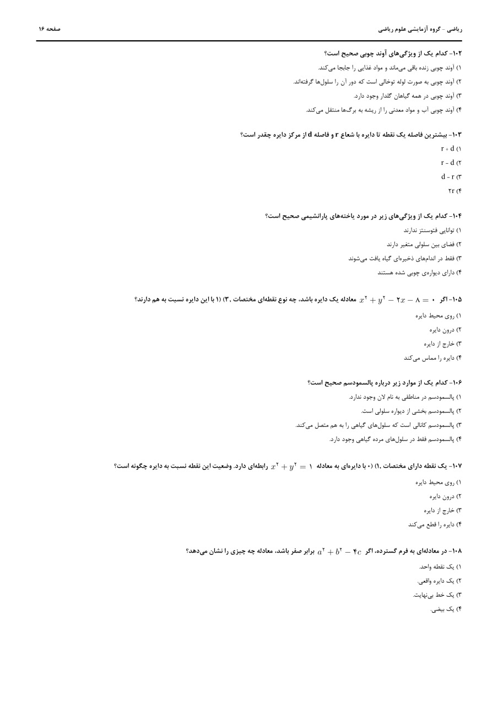

# konkoor_synth

This repository is created to synthisize Konkoor style pages:



# Installation

I used python 3.13

```pip install -r requirements.txt```

# Generation

Contact me to give the json of the questions data.
You can change anything you want from `.env` file, the existing settings is what that created the test dataset.

Then run

```python gen.py --json_path <QUESTIONS_DATA_JSON_PATH> --n <NUMBER_OF_SAMPLES_TO_GENERATE>```

If the generation stopped in the middle and you wanted to resume it from where it lastly was, you can run the command again. Otherwise, pass ```--overwrite``` option.

The image results will be saved to `<OUTPUT_PATH>/images` and the bounding box results would be saved to `<OUTPUT_PATH/bboxes.json`

# Evaluation

The evaluation process is done by calling the local OCR API. make sure you have access, then set the correct api url in `evaluation/.env`. For more information read [./evaluation/README.md](./evaluation/README.md)

If you read the evaluation readme and yet want to use the first evaluation method, to prepare the dataset for each model run the followings:

```python
python prepare_dataset.py --task blocks
python prepare_dataset.py --task crops --identifier title
python prepare_dataset.py --task crops --identifier word
```

Then continue [from here](./evaluation/README.md#if-you-want-the-first-method)


